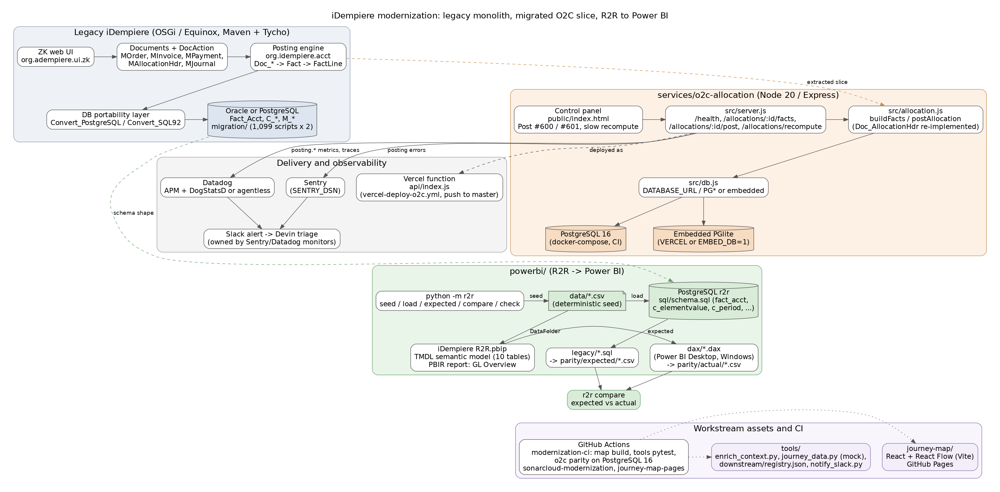

# Modernization architecture

How the Oracle → PostgreSQL modernization assets under `modernization/` fit around the legacy
iDempiere monolith, as of `master`. The analysis behind the decomposition is in
[`analysis/SYSTEM_ANALYSIS.md`](analysis/SYSTEM_ANALYSIS.md); the journey matrix and roadmap are in
[`plan/MIGRATION_PLAN.md`](plan/MIGRATION_PLAN.md).

Source: [`diagrams/architecture.dot`](diagrams/architecture.dot) (Graphviz). Edit it and run
`diagrams/render.sh` to regenerate [`architecture.png`](diagrams/architecture.png) and
[`architecture.svg`](diagrams/architecture.svg).

## Components

| Part | Path | Runtime | Role |
|---|---|---|---|
| Legacy iDempiere | repo root (`org.*` bundles, `migration/`) | Java / OSGi (Equinox), Maven + Tycho, Oracle or PostgreSQL | System being migrated. Documents complete through `DocAction`; `org.idempiere.acct` `Doc_*` classes post to `Fact_Acct`. |
| O2C allocation service | `services/o2c-allocation/` | Node 20, Express | First extracted deployable: allocation → GL posting re-implemented from `Doc_AllocationHdr` on PostgreSQL-native SQL. |
| R2R → Power BI | `powerbi/` | Python 3 CLI + PostgreSQL; Power BI Desktop (Windows) | iDempiere-shaped ledger, Power BI semantic model and report, and a legacy-SQL vs DAX parity harness. |
| Journey map | `journey-map/` | React 18 + React Flow 11, Vite 5 | Interactive journey/disposition map, published to GitHub Pages. |
| Enrichment tooling | `tools/` | Python 3 | Pre-work context for journey tickets: live CI + SonarCloud, mock data estate and downstream registry, Slack notifier, program metrics. |

## O2C allocation service

- **Code path.** `public/index.html` (control panel) → `src/server.js` (Express routes) →
  `src/allocation.js` (`buildFacts`, `postAllocation`, `recomputeBalances`) → `src/db.js`.
- **Routes.** `GET /health`, `GET /allocations/:id/facts`, `POST /allocations/:id/post`,
  `POST /allocations/recompute`. The control panel posts allocation **#600** (USD, balanced),
  **#601** (EUR, realized FX loss) and runs the slow recompute.
- **Accounting.** `buildFacts` emits UnallocatedCash, DiscountExp, WriteOff, Receivable and
  realized FX gain/loss lines; `postAllocation` rejects a posting whose debits ≠ credits
  (HTTP 422, `PostingNotBalancedError`) and otherwise writes `fact_acct`. Rates come from
  `c_conversion_rate` with `LEFT JOIN` / `COALESCE` instead of Oracle `(+)` / `NVL`.
- **Database modes** (`src/db.js`):
  - *Discrete PostgreSQL* when `DATABASE_URL` or `PG*` is set — `docker-compose.yml` (PostgreSQL 16
    on 5432) and CI. `npm run migrate` applies `src/sql/schema.sql` + `seed.sql`.
  - *Embedded PGlite* (in-process WASM PostgreSQL) when there is no `DATABASE_URL` and `VERCEL` is set
    or `EMBED_DB=1`. Schema and seed load on cold start; data is per-instance and not durable.
- **Deployment.** `api/index.js` exports the Express app as a Vercel function; `vercel.json`
  rewrites every path to `/api`, bundles `public/`, `src/` and the PGlite `dist/` assets, and sets
  `maxDuration` 60 s. `.github/workflows/vercel-deploy-o2c.yml` deploys to Vercel production on
  pushes to `master` that touch the service (or manual dispatch); there is no per-PR preview workflow.
  `Dockerfile` + `docker-compose.yml` run the same service locally with a Datadog agent.
- **Observability.** `src/telemetry/datadog.js` loads `dd-trace` first and sends `posting.*`
  metrics through DogStatsD (agent) or, on Vercel, the Datadog HTTP intake (agentless, needs
  `DD_API_KEY`). `src/telemetry/sentry.js` is active only when `SENTRY_DSN` is set; posting errors
  are captured and flushed before the response. The service never calls Slack: Sentry and Datadog
  monitors own the Slack alert that hands the incident to Devin.
- **Seeded regressions.** `ALLOC_BUG=1` drops the realized-FX balancing line, so #601 fails
  (debit 525 vs credit 550) while #600 still posts. `/allocations/recompute` runs an O(n²) scan
  (`RECOMPUTE_SCALE`, default 9000) that stands in for a dropped index, for latency monitors.
- **Tests.** `npm test` (`node --test`) runs `test/parity.test.js`: USD and EUR postings balance,
  the FX line is 25.00, and the seeded bug produces the imbalance.

## R2R → Power BI

- **Ledger.** `sql/schema.sql` creates iDempiere-shaped tables (`fact_acct`, `c_elementvalue`,
  `c_period`, `c_invoice`, `c_payment`, …). `python -m r2r seed` writes deterministic CSVs to
  `data/`; `python -m r2r load` loads them into PostgreSQL (`PG*` or `R2R_DSN`, database `r2r`).
- **Semantic model.** `pbi/iDempiere R2R.pbip` with a TMDL model in
  `pbi/iDempiere R2R.SemanticModel/` (10 tables: GL Journal, Account, Period, Date, Organization,
  Business Partner, BP Group, Invoice, Payment, Payment Term). Tables import `data/*.csv` through
  the `DataFolder` parameter; GL Journal carries the Debit / Credit / Balance / Out Of Balance /
  Budget Balance / Journal Lines measures. The PBIR report has one page, **GL Overview**.
- **Parity.** `legacy/*.sql` is the iDempiere report SQL; `python -m r2r expected <name>` writes
  `parity/expected/<name>.csv`. `dax/*.dax` is the Power BI equivalent, run in Power BI Desktop by
  `tools/windows/Invoke-Dax.ps1` into `parity/actual/`; `python -m r2r compare <name>` diffs the two.
  `python -m r2r check` validates the project's file references and model.
- **Tests.** `pytest tests` covers the model check and CSV comparison; the legacy-SQL parity test
  needs `PGHOST`. These tests are not in CI yet.

## CI and publishing

| Workflow | Trigger | Does |
|---|---|---|
| `modernization-ci.yml` | PRs and pushes touching `modernization/` | Journey-map `npm run build`; `tools` pytest; o2c-allocation `npm test` against PostgreSQL 16. |
| `sonarcloud-modernization.yml` | PRs and `master` pushes touching `modernization/` | SonarCloud scan; on a PR gate failure, posts the report and a Slack message that triggers Devin. |
| `journey-map-pages.yml` | `master` pushes touching `journey-map/` | Builds and publishes the map to https://cog-gtm.github.io/idempiere/. |
| `vercel-deploy-o2c.yml` | `master` pushes touching the service | Vercel production deploy of o2c-allocation. |
| `sonarqube.yml` | manual | The project's full SonarCloud analysis. |
